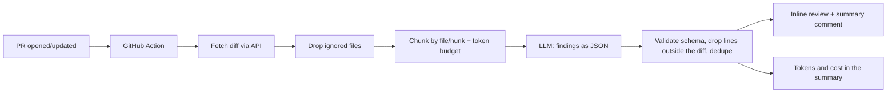

# pr-reviewer

First-pass pull request review with an LLM: inline comments and an idempotent summary, delivered by a GitHub Action, with schema-validated output, token/cost tracking and an eval suite.

> **Status:** code, tests, CI and a first real eval run are done (see [Results](#results)). The Groq comparison and the demo GIF are still to come.

<!-- DEMO: GIF of a PR with inline comments goes here -->

## Why it exists

Human reviewers spend their time on the obvious: a missing escape, a query in a loop, a swallowed exception. `pr-reviewer` takes a first pass so the person can focus on design and intent. It does **not** replace the human review. It is a public, from-scratch version of the review pipeline I run as a tech lead.

## How it works



- **Structured output, validated.** Every answer must match a Pydantic schema. On failure: one retry with the validation error in the prompt, then the chunk is logged as failed and the run continues.
- **Untrusted input.** The diff goes between `<diff>` tags with an instruction to treat it as data; a literal `</diff>` inside the diff is neutralised.
- **Post-processing.** Findings on lines that are not in the diff are dropped, low-confidence ones (`< 0.5`) only appear in the summary, near-duplicates (same file, line ±2, same category) are merged.
- **Idempotent.** The summary carries a `<!-- pr-reviewer -->` marker and is updated on every push; inline comments carry a fingerprint, so a finding already posted is not posted again.
- **Cost control.** Per-chunk and per-PR token budgets (estimated as chars/4); reported tokens and cost come from the API `usage` field. Free-tier 429s are waited out once, then the run moves on.
- **Providers.** One OpenAI-compatible client for Gemini and Groq (both have free tiers) or any compatible endpoint.

## Results

Eval suite: 16 cases (13 with a planted bug, 3 clean), PHP/Laravel and Python, covering security, bugs, performance and team conventions. A finding counts as correct when it hits the same file, the same category and a line within ±3.

Measured on 2026-11-02 with `reviewer evals` (raw output in [`evals/results/`](evals/results)), free tier, one run:

| Model | Precision | Recall | False-positive rate | Avg latency/case | Billed cost |
|---|---|---|---|---|---|
| gemini-3.5-flash-lite | 100% (12/12) | 92% (12/13) | 0% (0/3 clean cases) | 2.3 s | US$ 0 (free tier) |

The one miss is `php-inline-validation`, the "use Form Requests, not inline validation" team rule.

How to read this number honestly:
- **Small, synthetic suite.** 16 cases I wrote myself, each with a single, fairly obvious planted bug. Real PRs are messier, so treat these as a regression baseline, not as a claim about real-world accuracy.
- **One run, one model.** LLM output varies between runs. The Groq comparison is not measured yet.
- Cost is not estimated in US$ for the paid tier yet (no verified price table), so the report shows `n/a` for it.

## Usage

**GitHub Action** (add `GEMINI_API_KEY` as a repository secret):

```yaml
name: PR review
on:
  pull_request:
    types: [opened, synchronize, reopened]
permissions:
  contents: read
  pull-requests: write
jobs:
  review:
    runs-on: ubuntu-latest
    steps:
      - uses: actions/checkout@v4
      - uses: AmarilhaTiago/pr-reviewer@main
        with:
          provider: gemini        # gemini | groq | openai-compatible
          model: <model name from the provider docs>
          api-key: ${{ secrets.GEMINI_API_KEY }}
          rules-path: .reviewer/rules.md
          min-severity: minor     # minor | major | blocker
```

**CLI**

```bash
uv sync
cp .env.example .env              # set LLM_PROVIDER, LLM_MODEL, LLM_API_KEY
uv run reviewer review --diff change.diff --rules .reviewer/rules.md
uv run reviewer review --base main --format json
uv run reviewer evals
```

Limitation: pull requests from **forks** do not receive repository secrets, so the action skips itself (with a notice) instead of failing.

## Engineering decisions and trade-offs

- **Free tiers first.** Gemini and Groq run behind one OpenAI-compatible provider, so comparing models costs nothing. The free Gemini tier may use submitted data for product improvement: don't point it at private code.
- **Docker action** over composite: isolated, reproducible environment at the price of a slower first run.
- **Token estimate is rough** (chars/4) and only sizes chunks; billing numbers come from the API.
- **Hunks are never split further**, so a single huge hunk becomes its own oversized chunk.
- **Provider quirks.** `json_schema` response format is requested first and falls back to `json_object` if the provider rejects it; the Pydantic validation is the real contract.
- **Tests never call a real API.** Providers and GitHub are exercised with scripted HTTP transports; real calls happen only in the evals and the self-review workflow.

## Next steps

- Anthropic provider (paid, optional).
- Publish the token price table once verified against official pricing pages (cost shows `n/a` until then).
- More eval cases and languages.

## 🇧🇷 Resumo em português

Revisor de PR com LLM que roda como GitHub Action: comenta linhas específicas do PR e mantém um comentário-resumo que é atualizado a cada push, sem duplicar. A saída do modelo é validada por schema (com uma nova tentativa em caso de erro), o diff é tratado como dado não confiável, e tokens e custo aparecem no resumo. Há uma suíte de evals (16 casos em PHP e Python) que mede precisão, recall e falsos positivos em modelos gratuitos (Gemini e Groq). Os números só entram aqui depois de medidos de verdade. Não substitui a revisão humana: ele pega o óbvio para a pessoa focar no que importa. PRs vindos de forks não têm acesso aos secrets, então a action apenas avisa e pula.

## License

MIT
