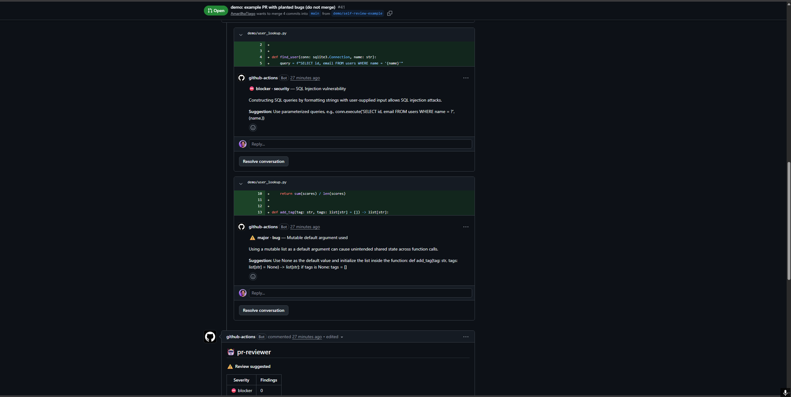
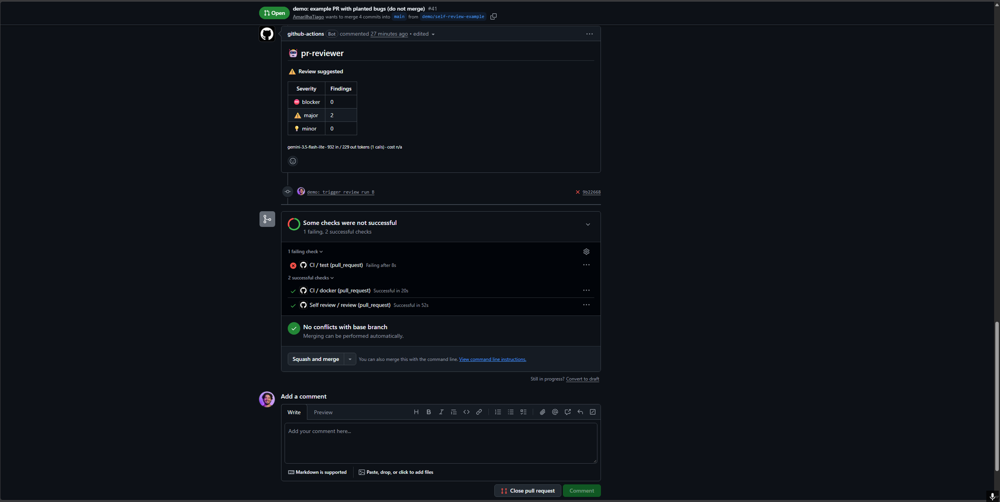
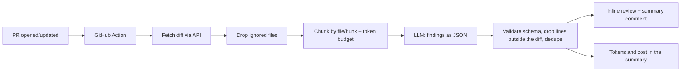

# pr-reviewer

First-pass pull request review with an LLM: inline comments and an idempotent summary, delivered by a GitHub Action, with schema-validated output, token/cost tracking and an eval suite.

**Live demo:** [PR #41](https://github.com/AmarilhaTiago/pr-reviewer/pull/41) is a real pull request with deliberately planted bugs, reviewed by this action: inline comments on the SQL injection and the mutable default argument, plus the summary comment that is updated (not duplicated) on every push. Its red `test` check is intentional: the repo's own linter also flags the planted bug, and the PR is never merged.





## Why it exists

Human reviewers spend their time on the obvious: a missing escape, a query in a loop, a swallowed exception. `pr-reviewer` takes a first pass so the person can focus on design and intent. It does **not** replace the human review. It is a public, from-scratch version of the review pipeline I run as a tech lead.

## How it works



- **Structured output, validated.** Every answer must match a Pydantic schema. On failure: one retry with the validation error in the prompt, then the chunk is logged as failed and the run continues.
- **Untrusted input.** The diff goes between `<diff>` tags with an instruction to treat it as data; a literal `</diff>` inside the diff is neutralised.
- **Post-processing.** Findings on lines that are not in the diff are dropped, low-confidence ones (`< 0.5`) only appear in the summary, near-duplicates (same file, line ±2, same category) are merged.
- **Idempotent.** The summary carries a `<!-- pr-reviewer -->` marker and is updated on every push; inline comments carry a fingerprint, so a finding already posted is not posted again.
- **Cost control.** Per-chunk and per-PR token budgets (estimated as chars/4); reported tokens and cost come from the API `usage` field. Free-tier 429s are waited out once, then the run moves on.
- **Providers.** One OpenAI-compatible client for Gemini and Groq (both have free tiers) or any compatible endpoint.

## Results

Eval suite: 16 cases (13 with a planted bug, 3 clean), PHP/Laravel and Python, covering security, bugs, performance and team conventions. A finding counts as correct when it hits the same file, the same category and a line within ±3.

Measured on 2026-11-02 with `reviewer evals` (raw JSON in [`evals/results/`](evals/results)), both models on their free tiers, 2 runs of each prompt version:

| Model | Prompt | Precision | Recall | False-positive rate (clean cases) | Avg API latency/case |
|---|---|---|---|---|---|
| gemini-3.5-flash-lite | hunk headers only (2 runs, same totals) | 100% | 92% | 0% | 1.6 s |
| gemini-3.5-flash-lite | **numbered lines**, run 1 | 100% | 100% | 0% | 1.3 s |
| gemini-3.5-flash-lite | **numbered lines**, run 2 | 100% | 77% | 0% | 1.3 s |
| openai/gpt-oss-120b (Groq) | hunk headers only (2 runs, same totals) | 79% | 85% | 0% | 1.8 s |
| openai/gpt-oss-120b (Groq) | **numbered lines**, run 1 | 87% | 100% | 0% | 1.7 s |
| openai/gpt-oss-120b (Groq) | **numbered lines**, run 2 | 86% | 92% | 0% | 1.5 s |

Every case costs US$ 0 (free tiers). Each run is 13 planted bugs + 3 clean cases; recall is out of 13 findings, precision out of everything the model reported.

**What changed between the two prompt versions.** In the first Groq runs, two misses were **line-number errors**: the model named the right problem with the right category but cited line 6 instead of 11, because the diff only had hunk headers and it had to count. The prompt now prefixes every added/context line with its line number in the new file ([card #44](docs/cards/044-line-numbers)).

How to read the table:
- **Groq improved in both runs** (recall 85% to 100% / 92%, precision 79% to 87% / 86%), and those two line-number misses are gone. Its remaining false positives are extra findings (for example a possible `None` access in `py-query-in-loop`), not wrong lines.
- **Gemini is inconclusive.** Recall was 100% in one run and 77% in the other, against 92% twice before. That spread is larger than any effect of the change. In the 77% run the three missed cases got no finding at all (zero false positives), so the cause is the model staying silent, not wrong lines.
- Groq spends about 4–5x more output tokens than Gemini (reasoning). Latency is API call time only; the waits that keep Groq under its free-tier limit (8K tokens/minute) are not counted.
- Before-change raw JSON is kept in [`evals/results/before-line-numbers/`](evals/results/before-line-numbers) (second run of each model; the first run had the same totals), after-change runs in [`after-line-numbers/`](evals/results/after-line-numbers).

How to read these numbers honestly:
- **Small, synthetic suite.** 16 cases I wrote myself, each with a single, fairly obvious planted bug, and a case set I also used to tune the prompt. Real PRs are messier, so treat these as a regression baseline, not as a claim about real-world accuracy.
- **Two runs per version**, not a statistical sample. LLM output varies between runs.
- The paid-tier cost is not estimated yet (no verified price table), so the report shows `n/a` for it.

## Usage

**GitHub Action** (add `GEMINI_API_KEY` as a repository secret):

```yaml
name: PR review
on:
  pull_request:
    types: [opened, synchronize, reopened]
permissions:
  contents: read
  pull-requests: write
jobs:
  review:
    runs-on: ubuntu-latest
    steps:
      - uses: actions/checkout@v4
      - uses: AmarilhaTiago/pr-reviewer@main
        with:
          provider: gemini        # gemini | groq | openai-compatible
          model: <model name from the provider docs>
          api-key: ${{ secrets.GEMINI_API_KEY }}
          rules-path: .reviewer/rules.md
          min-severity: minor     # minor | major | blocker
```

**CLI**

```bash
uv sync
cp .env.example .env              # set LLM_PROVIDER, LLM_MODEL, LLM_API_KEY
uv run reviewer review --diff change.diff --rules .reviewer/rules.md
uv run reviewer review --base main --format json
uv run reviewer evals
```

Limitation: pull requests from **forks** do not receive repository secrets, so the action skips itself (with a notice) instead of failing.

## Engineering decisions and trade-offs

- **Free tiers first.** Gemini and Groq run behind one OpenAI-compatible provider, so comparing models costs nothing. The free Gemini tier may use submitted data for product improvement: don't point it at private code.
- **Docker action** over composite: isolated, reproducible environment at the price of a slower first run.
- **Token estimate is rough** (chars/4) and only sizes chunks; billing numbers come from the API.
- **Hunks are never split further**, so a single huge hunk becomes its own oversized chunk.
- **Provider quirks.** `json_schema` response format is requested first and falls back to `json_object` if the provider rejects it; the Pydantic validation is the real contract.
- **Tests never call a real API.** Providers and GitHub are exercised with scripted HTTP transports; real calls happen only in the evals and the self-review workflow.

## Next steps

- More eval runs per model: Gemini's recall swung between 77% and 100% across two runs, so two runs cannot separate the prompt change from noise.
- More and messier eval cases (several bugs per diff, larger diffs, more languages).
- Publish the token price table once verified against official pricing pages (cost shows `n/a` for the paid tier until then).
- Anthropic provider (paid, optional).

## 🇧🇷 Resumo em português

Revisor de PR com LLM que roda como GitHub Action: comenta linhas específicas do PR e mantém um comentário-resumo que é atualizado a cada push, sem duplicar. A saída do modelo é validada por schema (com uma nova tentativa em caso de erro), o diff é tratado como dado não confiável, e tokens e custo aparecem no resumo. Há uma suíte de evals (16 casos em PHP e Python) que mede precisão, recall e falsos positivos em dois modelos gratuitos (Gemini e Groq), com custo de US$ 0. Numerar as linhas do diff no prompt melhorou o Groq nas duas rodadas (recall de 85% para 100% e 92%, precisão de 79% para 87% e 86%); no Gemini o resultado foi inconclusivo (recall entre 77% e 100% entre rodadas). Os casos são sintéticos e só há duas rodadas por versão, então os números são uma linha de base, não uma promessa de acerto em PRs reais. Não substitui a revisão humana: ele pega o óbvio para a pessoa focar no que importa. PRs vindos de forks não têm acesso aos secrets, então a action apenas avisa e pula.

## License

MIT
